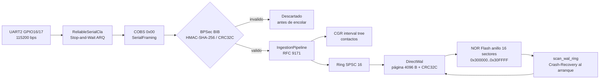

# dtn-esp32-node — Nodo BPv7 DTN sobre ESP32-WROOM-32

Firmware `no_std` / cero `alloc` para ESP32-WROOM-32 (Xtensa LX6 @ 240 MHz)
que integra el motor [`../dtn-core`](../dtn-core) (RFC 9171 / RFC 9172) con
`esp-hal` 1.2, `esp-storage` 0.10 y UART2. Todo el estado del nodo vive en
buffers estáticos: no hay heap, no hay RTOS y no hay timers de sistema.

## Arquitectura completa



### 1. Wear-leveling circular en SPI Flash NOR (64 KB)

| Parámetro | Valor |
| :--- | :--- |
| `WAL_START_OFFSET` | `0x30_0000` (3 MiB, fuera del firmware) |
| `WAL_SECTOR_COUNT` | `16` sectores de 4096 B |
| Región total | `0x30_0000 .. 0x30_FFFF` (64 KiB) |
| Siguiente slot | `(active_slot + 1) % 16` |

* **Crash-Recovery:** `scan_wal_ring()` hace dos pasadas sobre los 16 sectores
  reutilizando **un único buffer de 4096 B**. La primera localiza el `max_seq`
  y el sector activo; la segunda reproduce los registros válidos en orden de
  secuencia (cruzando el punto de wrap) e invoca el callback de recuperación.
  Sectores en blanco, escrituras parciales (*torn writes*) y generaciones
  obsoletas se descartan
  por CRC32C / monotonicidad.
* **En ejecución:** cada página WAL sellada se escribe rotando al siguiente
  sector **sin borrar los otros 15**. La secuencia del `DirectWal` se reanuda en
  `max_seq + 1` para que una página nueva nunca se confunda con una generación
  antigua. Resultado: **16x de vida útil** de la NOR frente a la escritura fija.
* Si un `erase`/`write` falla, la página permanece en el WAL RAM y se reintenta
  en el siguiente ciclo: no se anuncia durabilidad que no existe.

### 2. Capa de convergencia confiable sobre UART2 (COBS + Stop-and-Wait)

Cabecera ligera de enlace dentro de cada frame COBS:

| Offset | Tamaño | Campo |
| :--- | :--- | :--- |
| 0 | 1 | `Data=0x01`, `Ack=0x02`, `Nack=0x03` |
| 1 | 2 | `SeqId` (`u16`, big-endian, wrap-around) |
| 3 | N | Payload (bundle BPv7 o ADU reenviado) |

* **ARQ Stop-and-Wait** una sola trama en vuelo, ventana de timeout de
  `50_000 us` inyectada como tick `u64` desde `Instant::elapsed().as_micros()`
  (sin `std::time`, sin RTOS).
* `max_retries = 3`: tras agotar el presupuesto el enlace pasa a `Failed` y el
  bundle se retiene en el WAL en lugar de descartarse.
* ACK duplicado se responde sin volver a encolar; NACK dispara retransmisión
  inmediata; una trama corrupta se descarta de forma determinista.
* RX/TX: `ReliableSerialCla<256, 288, 256>` — COBS con delimitador `0x00`,
  GPIO16 RX / GPIO17 TX a 115200 bps.

### 3. BPSec BIB (RFC 9172) antes de encolar

* Bloque de extensión canónico tipo **11**, insertado **antes** del payload para
  conservar la regla RFC 9171 de que el payload es el último bloque canónico.
* Datos del bloque: `[context_id, scope, h'mac']` con contextos RFC 9173
  `1 = CRC-32C` y `2 = HMAC-SHA-256`. Entrada MAC con separación de dominio y
  longitud prefijada: `scope || context || len(primary) || primary || len(payload) || payload`.
* `BibVerifier` se ejecuta dentro de `IngestionPipeline` **antes** del ring
  SPSC y del WAL: integridad inválida produce `DropIntegrityFailed`.
* El firmware usa un verificador *opportunistic* (acepta bundles herederos sin
  BIB pero verifica cualquier BIB presente); el modo `required` está disponible
  y se ejercita en la suite de estrés.

### Presupuesto de memoria

| Buffer | Tamaño |
| :--- | :--- |
| Página WAL / flash compartida | 4096 B |
| COBS RX + RX decodificado + TX | 256 + 256 + 288 B |
| WAL RAM (`DirectWal<1>`) | 4096 B |
| Ring SPSC, reensamblado, CGR, adjuntos BIB | < 1 KB |
| **Total estático típico** | **< 11 KB SRAM** (520 KB disponibles) |

## Métricas medidas en silicio físico (ESP32-WROOM-32, 240 MHz)

| Métrica | Resultado |
| :--- | :--- |
| Pipeline BPv7 + CGR + WAL RAM (100x) | `min=10 us` \| `avg=12 us` \| `max=124 us` |
| Pipeline + verificación BPSec BIB | `533 - 553 us` hasta sellado WAL completo |
| Erase + write + verify CRC32C en NOR | `avg=43.29 ms` \| `max=45.30 ms` (10/10 OK) |
| Fuzzing CBOR / BPv7 / BIB (50 tramas) | **50/50 rechazadas, 0 panics** |
| Pull-the-Plug | Supervivencia confirmada: replay desde WAL/Flash |
| Soak test | **1 h 50 min** continuo sin panic ni corrupción |

> Las cifras anteriores son mediciones reales en hardware. El cambio a anillo
> de 16 sectores conserva el coste por página (`43.29 ms`) y distribuye el
> desgaste; no añade copias de 4096 B.

### Suite de estrés (`--features stress-test`)

| Prueba | Qué valida |
| :--- | :--- |
| 1/6 Pipeline 100x + BPSEC | Latencia min/avg/max con BIB verificado |
| 2/6 SPSC backpressure | 32 envíos con contacto activo hacia nodo 42 |
| 3/6 Fuzzing CBOR/BPSec | 50 mutaciones rechazadas limpiamente |
| 4/6 Wear-leveling 10x | Erase+write rotando sectores, CRC32C verificado |
| 5/6 UART2 COBS loopback | Bit-exact GPIO17 → GPIO16 (requiere jumper) |
| 6/6 ARQ + BPSec BIB | Stop-and-Wait completo, firma aceptada, alteración rechazada |

## Comparativa con otras implementaciones DTN

| Implementación | Lenguaje | Destino | Heap | BPv7 | BPSec BIB | CLA principales | Huella / latencia (*) |
| :--- | :--- | :--- | :--- | :--- | :--- | :--- | :--- |
| **dtn-esp32-node (este proyecto)** | Rust `no_std` | ESP32-WROOM-32 (Xtensa) | **0 B** | Sí | Sí (CRC32C + HMAC-SHA256) | UART2/COBS + ARQ confiable | **< 11 KB SRAM**, 10-12 us pipeline, 43.29 ms flash |
| ION-DTN | C | Linux / RTOS | Sí | Sí (completo) | Sí | UDP, TCP, LTP, BP over multiple CLA | Orden de MB de RAM; latencia dependiente de SO |
| µD3TN | C | Linux embebido / MCU | Sí (pequeño) | Sí | Sí (BIB) | UDP, TCP, serial (dtn) | Decenas de KB a cientos de KB |
| dtn7-rs | Rust (`std`/async) | Linux / servidor | Sí | Sí | Sí (BIB/BCS) | TCP, UDP, WebSockets | Orden de MB; latencia de red dominante |

(*) Las cifras de ION-DTN, µD3TN y dtn7-rs son valores orientativos de su
documentación pública y arquitectura, **no medidas en este banco de pruebas**.
La ventaja comparativa de este firmware es el funcionamiento *bare-metal* con
cero asignaciones, persistencia con OCR y enlace serial confiable sin RTOS.

## Compilación y verificación

```fish
# Comprobación Xtensa (release)
cargo +esp check --release --bin dtn-esp32-node
cargo +esp check --release --bin dtn-esp32-node --features stress-test

# Motor base en host (91 tests unitarios + 13 doctests).
# IMPORTANTE: ejecutarlo desde dtn-core, no desde aquí: Cargo toma la toolchain
# y el target del directorio actual, y el config de este repo apunta a
# xtensa-esp32-none-elf (build-std=core), donde las dependencias de test de
# dtn-core (criterion/serde/clap) no pueden compilar.
cd ../dtn-core && cargo test

# Flashing (usa el runner xtensa-esp32-none-elf de .cargo/config.toml)
cargo +esp run --release --bin dtn-esp32-node
```

Para el test 5/6 conecta un jumper entre GPIO17 (TX) y GPIO16 (RX); sin él la
prueba se marca `SKIPPED` y el resto de la suite continúa.

## Licencia

MIT o Apache-2.0, igual que `dtn-core`.
